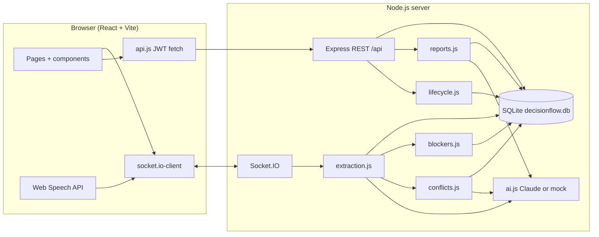
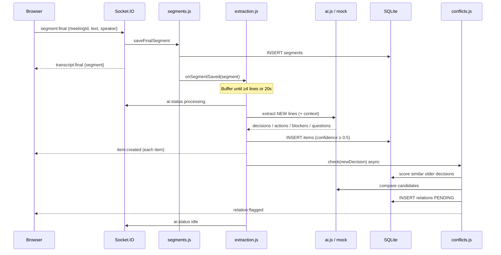
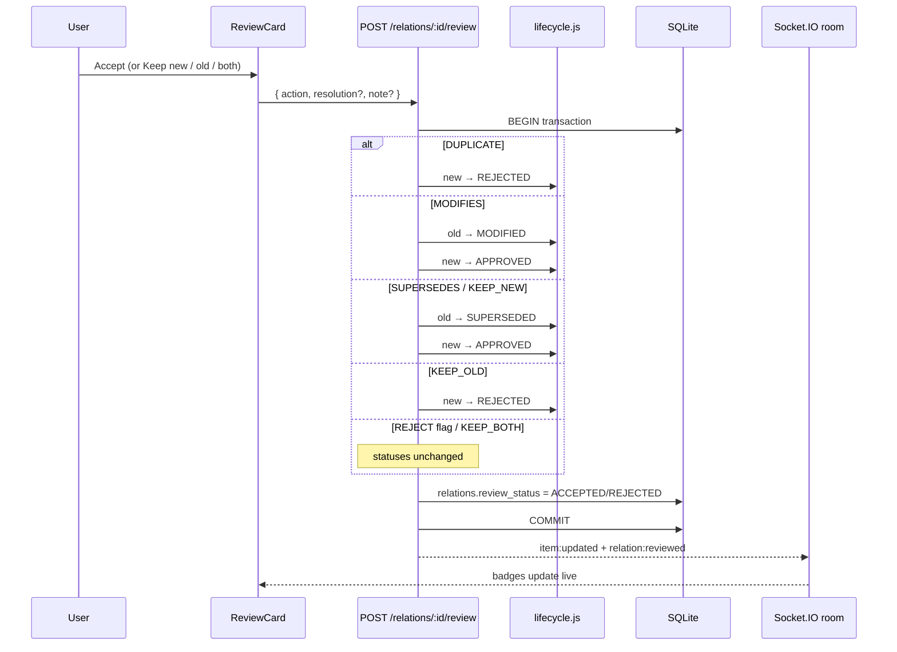

# DecisionFlow — Architecture

This document describes how the pieces fit together. The full product rules live in [SPEC.md](SPEC.md).

## Component overview

| Layer | Responsibility |
|---|---|
| **client/** | Login, project switcher, Live Meeting UI, review cards, charts, reports. Talks to the server over REST + Socket.IO. Never holds the Anthropic API key. |
| **server/routes/** | Thin HTTP handlers. Validate input, call services, return JSON `{ error }` on failure. |
| **server/services/** | Business logic: extraction buffering, conflict detection, recurring blockers, reports, decision/action lifecycle. |
| **server/schema.sql** | All tables + FTS5 indexes. Applied on every server start with `IF NOT EXISTS`. |
| **demo/** | Scripted transcripts (`Name: sentence`) for safe demos without a mic. |

## Live meeting sequence

What happens when a final transcript line arrives during a LIVE meeting:

## Conflict / review sequence

**Important rule:** the AI never changes a decision status. Only `lifecycle.js` does, and only through allowed transitions (SPEC §4). Invalid transitions return HTTP 409.

## Real-time rooms

- Each meeting is a Socket.IO room named `meeting:<id>`.
- Clients send the JWT in `io(url, { auth: { token } })`.
- Anyone who opens the Live Meeting page joins the room and sees the same transcript and cards. Only the host's browser runs the microphone.

## AI modes

| Mode | When | Behaviour |
|---|---|---|
| `AI_MODE=mock` (default) | No key, or explicit mock | Regex extraction + keyword comparison + template reports |
| `AI_MODE=claude` | `ANTHROPIC_API_KEY` set | Official `@anthropic-ai/sdk` with `zodOutputFormat` schemas |

Every AI/mock run is logged in `ai_runs` (kind, latency, OK/FAILED).
