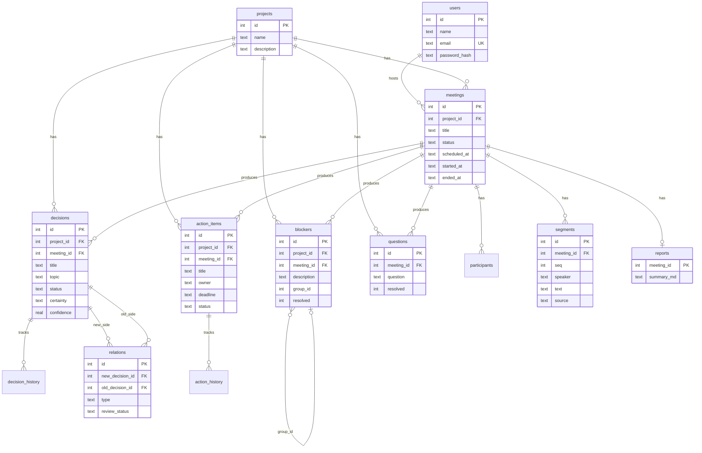

# DecisionFlow — Database

SQLite file: `server/data/decisionflow.db`. Schema: `server/schema.sql` (runs on every server start).

Pragmas: `foreign_keys = ON`, `journal_mode = WAL`.

## ER diagram

## Table summary

| Table | Purpose |
|---|---|
| `users` | Login accounts (`email` unique, `password_hash` via bcrypt). |
| `projects` | Top-level container. Most list APIs filter by `project_id`. |
| `meetings` | `SCHEDULED` → `LIVE` → `ENDED`. Host is `host_user_id`. |
| `participants` | Display names for the speaker dropdown / owner matching. |
| `segments` | Final transcript lines. `source` ∈ MIC, MANUAL, UPLOAD, DEMO. |
| `decisions` | Extracted decisions. Status lifecycle in SPEC §4. Keywords stored as JSON text. |
| `decision_history` | Append-only status changes. `changed_by` NULL = system. |
| `relations` | AI/mock flags between a new and an older decision. Unique `(new, old)`. |
| `action_items` | Tasks with optional owner + `deadline` (YYYY-MM-DD). |
| `action_history` | Field-level changes (status / owner / deadline). |
| `blockers` | Impediments. `group_id` links recurring mentions across meetings. |
| `questions` | Open questions; `resolved` + optional `resolved_in_meeting_id`. |
| `reports` | One Markdown summary per meeting (`meeting_id` PK). |
| `ai_runs` | Latency/status log for EXTRACT / COMPARE / SUMMARY. |
| `decisions_fts` / `segments_fts` | FTS5 external-content indexes (kept in sync by triggers). |

## Status values

**Decision:** `PROPOSED` → `APPROVED` | `REJECTED`; `APPROVED` → `MODIFIED` | `SUPERSEDED`.

**Action item:** `OPEN`, `IN_PROGRESS`, `DONE`, `BLOCKED`. Overdue = `deadline < today` and status ≠ `DONE`.

**Relation type:** `DUPLICATE`, `MODIFIES`, `SUPERSEDES`, `CONFLICTS`.  
**Relation review:** `PENDING` → `ACCEPTED` | `REJECTED`.

## Notes for viva

- Arrays (`keywords`, `source_segment_ids`, `changed_fields`) are JSON text, not separate tables — keeps the schema small for a prototype.
- Nothing important is deleted: status changes go to history tables; rejecting a relation only flips `review_status`.
- All user-facing SQL uses prepared statements (`db.prepare(...).run/?get/?all`).
